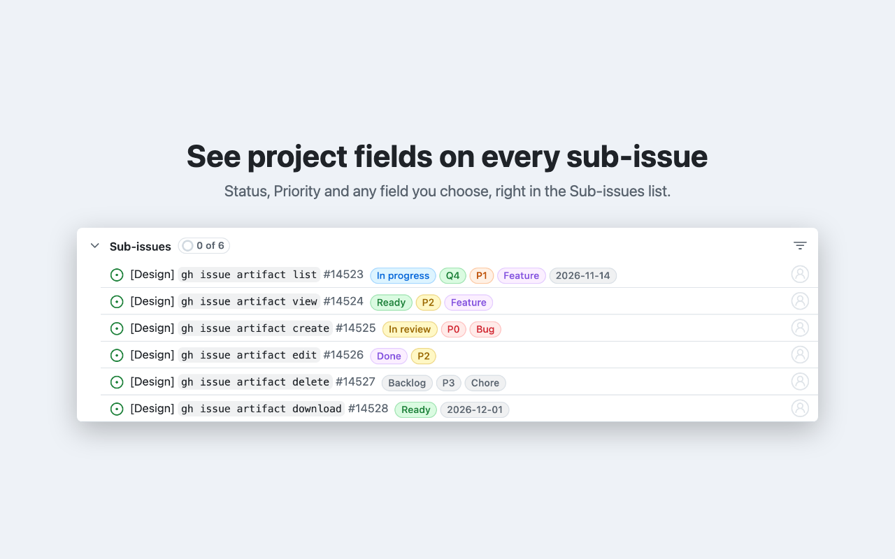

# Sub-issue Fields for GitHub

A Chrome extension that shows GitHub Projects field values, such as Status, Priority or any field you choose, as coloured pills on each row of an issue's Sub-issues list. It works on issue pages and on issues opened from a project board.

## Install

- **Chrome Web Store:** coming soon.
- **From source:** clone this repo, open `chrome://extensions`, turn on Developer mode, click **Load unpacked** and choose the repo folder. Works in any Chromium browser (Chrome, Edge, Arc, Dia, Brave).

## Set up

1. Create a [classic personal access token](https://github.com/settings/tokens/new?scopes=repo,read:project&description=Sub-issue%20Fields%20for%20GitHub) with the `repo` and `read:project` scopes.
2. If your organisation uses SAML single sign-on, click **Configure SSO** next to the token and authorise it for that organisation.
3. Click the extension's toolbar icon, paste the token, and optionally change the field list (default `Status, Priority, Kind, Deadline`). Pills appear in the order you list the fields; names are matched case-insensitively.

## How it works

When an issue page shows a Sub-issues list, the extension makes one GraphQL request for that issue's sub-issues and their project field values, then adds pills after each title. Single-select fields use the option's colour from the project; dates, text, numbers and iterations show as grey pills. Your token stays in `chrome.storage.local` and is only sent to `api.github.com`. See [PRIVACY.md](PRIVACY.md).

## Troubleshooting

Open DevTools on the issue page, pick **Sub-issue Fields for GitHub** in the Console's context dropdown, and look for `[sub-issue-fields]` warnings. `Bad credentials` means the token is wrong; a SAML message means the token isn't authorised for the organisation.

## Develop

- `npm test` runs the unit tests (Node 20+, no dependencies).
- `npm run package` builds `dist/gh-subissue-fields.zip` for the Chrome Web Store.

GitHub's issue page markup changes from time to time. The selectors that find sub-issue rows live at the top of `content.js`; they use `data-*` attributes because GitHub's CSS class names are hashed and change between deploys.

## Licence

MIT. Not affiliated with or endorsed by GitHub.
